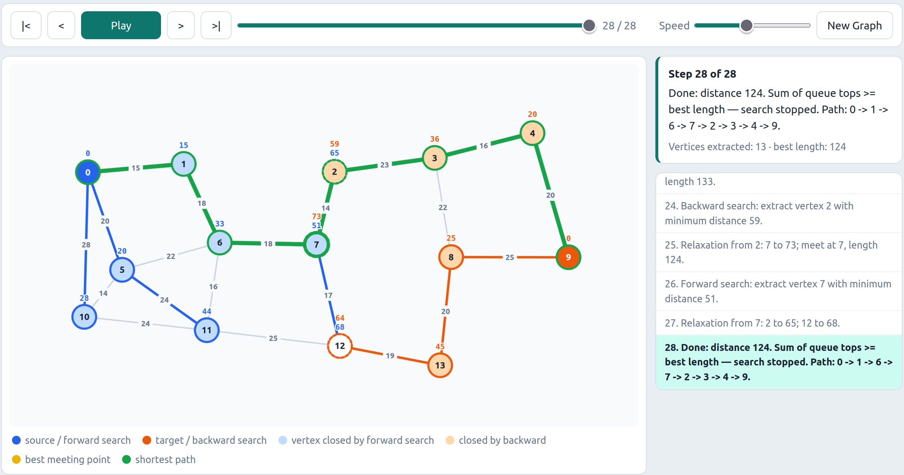

# Advanced Shortest Paths

A collection of shortest-path graph algorithms with an [`interactive web-based visualization`](https://tacitus-sl.github.io/shortest-paths-visualized/visualization.html).



## Educational Project
Developed as part of Algorithm Engineering course at NUP 2026.

## Algorithms

### 1. Bidirectional Dijkstra (`friend_suggestion.cpp`)
Runs two Dijkstra searches simultaneously: one forward from the source and one backward from the target. The algorithm stops when the two search frontiers meet. This roughly halves the search space compared to standard Dijkstra.

**Key idea:** Maintain two priority queues and alternate between them, pruning when `top(forward) + top(backward) ≥ best_known_distance`.

### 2. A\* Search (`dist_with_coords.cpp`)
Extends Dijkstra with an admissible heuristic `h(n)` that estimates the remaining cost to the target. It prioritizes nodes by `f(n) = g(n) + h(n)`, where `g(n)` is the cost from the source. With Euclidean distance as the heuristic, A\* explores far fewer nodes than Dijkstra while still guaranteeing the optimal path.

**Key idea:** Use coordinate-based Euclidean distance as the heuristic to guide the search toward the target.

### 3. Contraction Hierarchies (`dist_preprocess.cpp`)
A preprocessing technique that adds shortcut edges to the graph. During preprocessing, vertices are contracted one by one; for each contracted vertex, shortcuts are added between its neighbors to preserve shortest-path distances. At query time, a bidirectional search runs only on upward edges (toward higher-ranked vertices), making queries extremely fast.

**Key idea:** Contract low-importance vertices first, add witness-verified shortcuts, then query using only upward edges in the augmented graph.


### 4. Traveling Salesman Problem (`travelling_salesman_problem.cpp`)
Finds the shortest tour visiting a set of cities and returning to the start. Uses Contraction Hierarchies for all-pairs shortest distances between cities, then solves the TSP via the Held-Karp dynamic programming algorithm in O(k²·2ᵏ) time over k cities.

**Key idea:** Precompute all-pairs shortest paths with CH, then apply bitmask DP (Held-Karp) to find the optimal tour.

## Real-World Applications

| Algorithm | Where It's Used | Example |
|---|---|---|
| **Bidirectional Dijkstra** | Social networks, online path queries | "Friend suggestions" - finding the shortest social path between two people on Facebook or LinkedIn. Also used for single on-the-fly route queries in navigation systems when no preprocessing is available. |
| **A\* Search** | Game AI, GPS navigation, robotics | Pathfinding for characters in video games (e.g., RTS units navigating a map). GPS devices use A\* when coordinates are known to quickly find routes. Also applied in robot motion planning and puzzle solvers (15-puzzle, Rubik's cube). |
| **Contraction Hierarchies** | Road routing engines, map services | OSRM (Open Source Routing Machine) and Google Maps use CH to answer thousands of route queries per second on road networks. Preprocessing takes hours, but each query returns in milliseconds — 100–1000× faster than Dijkstra. |
| **Traveling Salesman Problem** | Logistics, manufacturing, genomics | Delivery route optimization for courier services (Amazon, FedEx). PCB drilling - ordering holes to minimize drill head movement. DNA fragment assembly in genomics. Production scheduling on CNC machines. |

### When to Choose Which Algorithm

- **One query, no preprocessing?** → Bidirectional Dijkstra cuts the search space in half compared to standard Dijkstra.
- **Coordinates available, single target?** → A\* uses geometry to guide the search and explores far fewer nodes.
- **Thousands of queries on a static graph?** → Contraction Hierarchies pay off after preprocessing with extremely fast queries.
- **Visit multiple cities and return?** → TSP (Held-Karp) finds the optimal tour for small city sets (≤ 20 cities).

## Interactive Visualization

Open [`visualization.html`](https://tacitus-sl.github.io/shortest-paths-visualized/visualization.html) in any modern browser to see step-by-step animations of all four algorithms.

### Features
- **Tabbed interface** — switch between algorithms
- **Step-by-step animation** — watch each algorithm explore the graph
- **Adjustable speed** — control animation speed with a slider
- **Execution log** — see detailed step-by-step output
- **Statistics** — visited nodes, relaxations, time
- **Random graph generation** — generate new graphs to test different scenarios
- **Interactive node selection** — click nodes to set source, target, or TSP cities

### How to Use

| Algorithm | Interaction |
|---|---|
| **Bidirectional Dijkstra** | Click two nodes (source + target), then press Run |
| **A\* Search** | Click two nodes (source + target), then press Run |
| **Contraction Hierarchies** | Press Preprocess to contract vertices, then click two nodes and press Query |
| **Traveling Salesman** | Click 3+ nodes to mark as cities, then press Solve TSP |

## Project Structure

```
├── friend_suggestion.cpp    # Bidirectional Dijkstra
├── dist_with_coords.cpp      # A* with Euclidean heuristic
├── dist_preprocess.cpp # Contraction Hierarchies
├── travelling_salesman_problem.cpp  # CH + Held-Karp TSP
└──  visualization.html             # Interactive visualization
```

## Building and Running

Each C++ file is self-contained and can be compiled with:

```bash
g++ -O2 -std=c++17 -o algorithm algorithm.cpp
./algorithm < input.txt
```

## References

- Dijkstra, E. W. (1959). "A Note on Two Problems in Connexion with Graphs"
- Goldberg, C. & Harrelson, C. (2005). "Route Planning in Road Networks" (Contraction Hierarchies)
- Hart, P. E., Nilsson, N. J., & Raphael, B. (1968). "A Formal Basis for the Heuristic Determination of Minimum Cost Paths" (A*)
- Held, M. & Karp, R. (1962). "A Dynamic Programming Approach to Sequencing Problems" (TSP)
